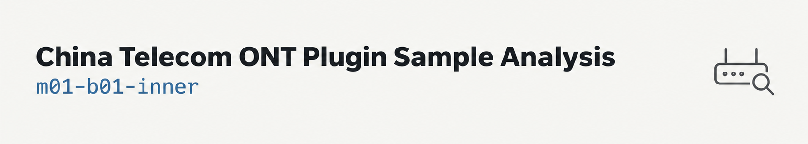

<p align="right"><a href="README.md">简体中文</a> | <b>English</b></p>



# `m01-b01-inner`: China Telecom ONT plugin samples from Shanghai and Zhejiang

This is a plugin preinstalled on China Telecom optical network terminals (ONTs, the fibre "modem" in the home). It can collect an inventory of household devices and part of their web activity and report them, and it can run commands sent from a remote server. This repository contains the original `init.bin` files, the complete Lua source and module indexes for two regional samples.

ONTs from China Telecom Shanghai and China Telecom Zhejiang carry different versions of `m01-b01-inner`. Both versions ship their Lua source as `init.bin`, compressed with zlib and encrypted with AES-128-ECB.

| Sample | `init.bin` size | Lua source size | Modules (incl. libraries) |
|---|---:|---:|---:|
| Shanghai | 244,440 bytes | 1,151,589 bytes | 119 |
| Zhejiang | 141,160 bytes | 661,590 bytes | 90 |

## Sample origin and scope

Both samples were taken from ONTs in service in November 2026. After decryption and decompression, each original `init.bin` is byte-identical to the Lua text held in the running plugin's memory.

| Content | Included |
|---|---|
| Original `init.bin` and complete Lua text `init.lua` | Yes, original bytes. SHA-256 in [FORMAT.md](FORMAT.md) |
| Single-page excerpt `init.public.lua` | Kept. The complete source is `init.lua` in the same folder |
| Source excerpts, module indexes | Yes. Line numbers refer to the Lua text of the device originals |

## File structure

`init.bin` consists of a 24-byte header followed by the ciphertext:

```text
offset 0    4 bytes   constant 20 18 04 12
offset 4    4 bytes   total file size in bytes
offset 8    4 bytes   compressed stream size in bytes
offset 12   4 bytes   Lua text size in bytes (big-endian)
offset 16   4 bytes   zero
offset 20   4 bytes   Lua text size in bytes (little-endian, same as offset 12)
offset 24   to end    AES-128-ECB ciphertext
```

After decrypting the body, take the zlib stream of the length declared at offset 8 and decompress it to obtain the Lua text. In both samples the compressed stream is byte-identical to zlib level 9 output. Field values and original fingerprints are in [FORMAT.md](FORMAT.md) (Chinese).

## Shared features

| Module | Behaviour and defaults |
|---|---|
| `topo` | Links the device inventory to the broadband account, the ONT registration ID (LOID), serial number, Wi-Fi names and LAN/WAN IPs. Per-device fields include MAC, hostname, brand and model, OS, online time and traffic. By default the full inventory is reported daily and online devices hourly. |
| `http_imei`, `sigcollect` | By default matches a 15-digit value named `imei` in plaintext HTTP URLs and cookies and adds it to the reported device fingerprint. |
| `domain_dip` | After a device contacts a specified smart-home service, records the other domains and IPs that device contacts within the next 10 seconds. On by default, reported every 4 hours. |
| `http`, `https`, `rawpkt`, `pcap_dump` | Parses URL, referrer, user agent and cookie of plaintext HTTP requests and identifies the domain visible in HTTPS connections. Supports rule-based capture, recording and replay of packets. The Zhejiang `http` help string says `get dns`, but the code parses the same fields as the Shanghai version. |
| `hredirect` | Redirects plaintext HTTP requests by domain and path. Off by default, empty rule table. |
| `pktpolicy`, `appctrl`, `appmlp` | Drops packets, aborts connections or changes traffic priority per device, application and time window. |
| `pscan` | Downloads nmap renamed to `n01` and scans the LAN with `-sV` (service version detection). Reports device addresses, open ports, service names and versions; output from scan scripts is reported as type `dev_vuln`. Default period zero. |
| `shell`, `hotpatch`, `upgrade` | Runs system commands sent by the server with the plugin's privileges and returns the output; loads Lua modules at runtime; updates scripts, detection rules and the plugin. |

Key source lines for each module follow. Each summary line gives the module's location in the complete source; line numbers inside the code blocks refer to the Shanghai `init.lua` unless marked otherwise.

<details>
<summary><code>topo</code> · Shanghai <a href="samples/shanghai/init.lua#L28283-L29513">L28283-L29513</a> · Zhejiang <a href="samples/zhejiang/init.lua#L17635-L18826">L17635-L18826</a></summary>

```lua
-- L28303
send_period = 86400,
send_active_period = 3600,
-- <...>
-- L28434
add_value(gw_info, "2g_ssid", wifi_info["2g_ssid"], "")
-- <...>
-- L28447
add_value(gw_info, "pppoe", pppoe.pppoe, "")
add_value(gw_info, "loid", poninfo.loid, "")
-- <...>
-- L28450
add_value(gw_info, "wan_ip", netinfo.wan_ip, "")
-- <...>
-- L28858
info.hostname = laninfo.hostname
-- <...>
-- L28861
info.ip = laninfo.ip
```

</details>

<details>
<summary><code>http_imei</code> · Shanghai <a href="samples/shanghai/init.lua#L7670-L7866">L7670-L7866</a> · Zhejiang <a href="samples/zhejiang/init.lua#L4562-L4758">L4562-L4758</a></summary>

```lua
-- L7701
keywords = {"imei"},
-- <...>
-- L7703
attr = {"url", "cookie"},
```

</details>

<details>
<summary><code>sigcollect</code> · Shanghai <a href="samples/shanghai/init.lua#L22455-L22916">L22455-L22916</a> · Zhejiang <a href="samples/zhejiang/init.lua#L12847-L13258">L12847-L13258</a></summary>

```lua
-- L22470
enable = true,
-- <...>
-- L22473
newdev_period = 600,
-- <...>
-- L22480
coll_type = {"term_http","hostname","elink","mdns","upnp","vendor","dhcp_hostname","imei","mac","devname","term_pkt","term_domain"},
```

</details>

<details>
<summary><code>domain_dip</code> · Shanghai <a href="samples/shanghai/init.lua#L6606-L6818">L6606-L6818</a> · Zhejiang <a href="samples/zhejiang/init.lua#L3717-L3929">L3717-L3929</a></summary>

```lua
-- L6623
upperiod = 14400,
-- <...>
-- L6716
add_sig(mac, domainip, time, false)  -- add other sig within 10 seconds
```

</details>

<details>
<summary><code>http</code> · Shanghai <a href="samples/shanghai/init.lua#L7506-L7668">L7506-L7668</a> · Zhejiang <a href="samples/zhejiang/init.lua#L4417-L4560">L4417-L4560</a></summary>

Shanghai sample:

```lua
-- L7517
help = "get http from kernel and send to server",
period = 0,
-- <...>
-- L7538
http_table.url, next_pos = string.unpack(string.format("c%d", url_len), sbytes, next_pos)
-- <...>
-- L7541
http_table.ref, next_pos = string.unpack(string.format("c%d", ref_len), sbytes, next_pos)
-- <...>
-- L7544
http_table.ua, next_pos = string.unpack(string.format("c%d", ua_len), sbytes, next_pos)
-- <...>
-- L7547
http_table.cookie, next_pos = string.unpack(string.format("c%d", cookie_len), sbytes, next_pos)
```

Zhejiang sample:

```lua
-- L4428
help = "get dns from kernel and send to server",
-- <...>
-- L4448
http_table.url, next_pos = string.unpack(string.format("c%d", url_len), sbytes, next_pos)
-- <...>
-- L4451
http_table.ref, next_pos = string.unpack(string.format("c%d", ref_len), sbytes, next_pos)
-- <...>
-- L4454
http_table.ua, next_pos = string.unpack(string.format("c%d", ua_len), sbytes, next_pos)
-- <...>
-- L4457
http_table.cookie, next_pos = string.unpack(string.format("c%d", cookie_len), sbytes, next_pos)
```

</details>

<details>
<summary><code>https</code> · Shanghai <a href="samples/shanghai/init.lua#L9335-L9426">L9335-L9426</a> · Zhejiang <a href="samples/zhejiang/init.lua#L5730-L5816">L5730-L5816</a></summary>

```lua
-- L9349
help = "get https from kernel and send to server"
-- <...>
-- L9361
type = "https_domain",
-- <...>
-- L9369
domain = svrname,
```

</details>

<details>
<summary><code>rawpkt</code> · Shanghai <a href="samples/shanghai/init.lua#L21501-L21947">L21501-L21947</a> · Zhejiang <a href="samples/zhejiang/init.lua#L11970-L12407">L11970-L12407</a></summary>

```lua
-- L21519
help = "get rawpkt from kernel and send to server",
-- <...>
-- L21522
conn_limit_pkts = 16, -- max pkts in one conn(tuple), 0 means no limit
```

</details>

<details>
<summary><code>pcap_dump</code> · Shanghai <a href="samples/shanghai/init.lua#L16553-L16676">L16553-L16676</a> · Zhejiang <a href="samples/zhejiang/init.lua#L10318-L10339">L10318-L10339</a></summary>

```lua
-- L16563
help = "read/write/stat/replay pcap",
```

</details>

<details>
<summary><code>hredirect</code> · Shanghai <a href="samples/shanghai/init.lua#L7365-L7504">L7365-L7504</a> · Zhejiang <a href="samples/zhejiang/init.lua#L4286-L4415">L4286-L4415</a></summary>

```lua
-- L7376
help = "redirect http from server",
-- <...>
-- L7380
enable = false,
rules = {},
```

</details>

<details>
<summary><code>pktpolicy</code> · Shanghai <a href="samples/shanghai/init.lua#L16770-L17284">L16770-L17284</a> · Zhejiang <a href="samples/zhejiang/init.lua#L10341-L10822">L10341-L10822</a></summary>

```lua
-- L16787
help = "set pktpolicy and send info to server",
-- <...>
-- L16800
enable = true,
```

</details>

<details>
<summary><code>appctrl</code> · Shanghai <a href="samples/shanghai/init.lua#L761-L1046">L761-L1046</a> · Zhejiang <a href="samples/zhejiang/init.lua#L3-L272">L3-L272</a></summary>

```lua
-- L777
help = "set appctrl and send info to server",
```

</details>

<details>
<summary><code>appmlp</code> · Shanghai <a href="samples/shanghai/init.lua#L1048-L1350">L1048-L1350</a> · Zhejiang <a href="samples/zhejiang/init.lua#L730-L1032">L730-L1032</a></summary>

```lua
-- L1063
help = "set appmlp and real time send info to server",
```

</details>

<details>
<summary><code>pscan</code> · Shanghai <a href="samples/shanghai/init.lua#L18040-L18443">L18040-L18443</a> · Zhejiang <a href="samples/zhejiang/init.lua#L11568-L11968">L11568-L11968</a></summary>

```lua
-- L18055
period = 0,
-- <...>
-- L18058
argv = ' --max-rate 10 -sV -oX ',
prog = 'n01',
-- <...>
-- L18070
help = "parse n01 result and send to oper_data"
-- <...>
-- L18129
local one = {type = "dev_vuln", mac = mac, ip = ip, script_name = script.id or "", vuln_info = cjson.encode(info)}
-- <...>
-- L18145
service = get_attr(v.kids, "service", {name = true, version = true, product = true})
-- <...>
-- L18149
local one = {type = "pscan_v1", mac = mac, ip = ip, port = portid, proto = port.protocol or "", status = state.state or "", svr = service.name or "", version = service.version or "", product = service.product or ""}
-- <...>
-- L18334
-- download nmap tarball to tmp path
```

</details>

<details>
<summary><code>shell</code> · Shanghai <a href="samples/shanghai/init.lua#L22300-L22337">L22300-L22337</a> · Zhejiang <a href="samples/zhejiang/init.lua#L12692-L12729">L12692-L12729</a></summary>

```lua
-- L22306
help = "run shell cmd and return result",
```

</details>

<details>
<summary><code>hotpatch</code> · Shanghai <a href="samples/shanghai/init.lua#L7212-L7363">L7212-L7363</a> · Zhejiang <a href="samples/zhejiang/init.lua#L4142-L4284">L4142-L4284</a></summary>

```lua
-- L7222
help = "hot fixbug, and hot add more function",
```

</details>

<details>
<summary><code>upgrade</code> · Shanghai <a href="samples/shanghai/init.lua#L29710-L29818">L29710-L29818</a> · Zhejiang <a href="samples/zhejiang/init.lua#L19003-L19111">L19003-L19111</a></summary>

```lua
-- L29719
help = "upgrade for plugin/lua/sig",
```

</details>

## Modules found only in the Shanghai sample

| Module | Behaviour and defaults |
|---|---|
| `xid` | Matches phone numbers, IMEI, IMSI (mobile subscriber identity), advertising IDs and latitude/longitude fields in plaintext HTTP URLs, referrers and cookies, and links them to the device and domain. Reported every 30 minutes by default. |
| `coll_domain` | Counts domain visits, duration and referrer per device. Contains URL rules for Eastmoney, 10jqka (Tonghuashun), iwencai and Xueqiu to extract stock codes. Default upload period zero. |
| `crawler` | Receives up to 30 URLs per batch, fetches them through the subscriber's broadband connection and returns the page content to the platform. Off by default. |
| `onvif` | Discovers LAN cameras, queries model, serial number and firmware, and tries to authenticate with an account list configured by the platform. Default period zero. |
| `termact` | Matches specific SMB2 file-sharing packets sent to port 445 and passes the application-layer content with the device address to the reporting module. Rules also cover DHCPv6, mDNS, some IPTV and Xiaomi device traffic, and multicast. Off by default. |
| `xapp`, `quic`, `httpdns` | `xapp` can record URLs, cookies, referrers and parts of packet content; the related traffic reporting is off by default. `quic` identifies domains in some HTTP/3 connections; `httpdns` records answers from specific DNS-over-HTTP services. |
| `qrcstats` | Scans nearby Wi-Fi networks. Default period zero. |

<details>
<summary><code>xid</code> · Shanghai <a href="samples/shanghai/init.lua#L30826-L31050">L30826-L31050</a></summary>

```lua
-- L30842
upload_mode = "svrdata",   -- "none", "svrdata", "operdata", "all"
-- <...>
-- L30845
period = 1800,
-- <...>
-- L30855
attr = {"url", "ref", "cookie"},
```

</details>

<details>
<summary><code>coll_domain</code> · Shanghai <a href="samples/shanghai/init.lua#L3989-L4255">L3989-L4255</a></summary>

```lua
-- L4003
help = "collect domain/stock data and send to svrdata",
-- <...>
-- L4010
upload_period = 0,  -- default disable
session_period = 1800,
-- <...>
-- L4015
["gbapi.eastmoney.com"] = {url = {"[?&]code=%u*(%d+)&?"}},
["ai.10jqka.com.cn"] = {url = {"[?&]code=%u*(%d+)&?"}},
["www.iwencai.com"] = {url = {"[?&]q=%u*(%d+)&?"}},
-- <...>
-- L4019
["stockpage.10jqka.com.cn"] = {url = {"[^/]/%u*(%d+)/?"}},
["xueqiu.com"] = {url = {"[^/]/%u*(%d+)/?"}},
-- <...>
-- L4022
["quote.eastmoney.com"] = {ref = {"[^/]/%a*(%d+).html"}},
["myfavor.eastmoney.com"] = {ref = {"[^/]/%a*(%d+).html"}},
-- <...>
-- L4076
tt.stock_code = dtype_value or ""
```

</details>

<details>
<summary><code>crawler</code> · Shanghai <a href="samples/shanghai/init.lua#L4363-L4696">L4363-L4696</a></summary>

```lua
-- L4388
enable = false,         -- default is disable
-- <...>
-- L4390
max_crawl_cnt = 30,     -- maximum number of climbs
```

</details>

<details>
<summary><code>onvif</code> · Shanghai <a href="samples/shanghai/init.lua#L14832-L15356">L14832-L15356</a></summary>

```lua
-- L14848
help = "support to collect sig of onvif",
period = 0, -- default close
```

</details>

<details>
<summary><code>termact</code> · Shanghai <a href="samples/shanghai/init.lua#L27881-L28148">L27881-L28148</a></summary>

```lua
-- L27896
help = "collect termact to server",
-- <...>
-- L27899
enable = false,
-- <...>
-- L27901
-- Samba, tcp dst port 445, "4,FE534D42", "16,01002100"
```

</details>

<details>
<summary><code>xapp</code> · Shanghai <a href="samples/shanghai/init.lua#L30239-L30824">L30239-L30824</a></summary>

```lua
-- L30255
help = "send appinfo to server",
-- <...>
-- L30259
flow_enable = false,        -- 是否采集流特征数据，默认关闭
tag_enable = false,         -- 是否采集标签特征数据，默认关闭
```

</details>

<details>
<summary><code>quic</code> · Shanghai <a href="samples/shanghai/init.lua#L20814-L21499">L20814-L21499</a></summary>

```lua
-- L20825
help = "get quic from PCAP and send to server",
-- <...>
-- L20828
upload_mode = "none", -- "none", "svrdata", "operdata", "all"
```

</details>

<details>
<summary><code>httpdns</code> · Shanghai <a href="samples/shanghai/init.lua#L8844-L9333">L8844-L9333</a></summary>

```lua
-- L8858
help="http dns parse",
-- <...>
-- L8860
enable = true,
-- <...>
-- L8863
upload_enable = false,
```

</details>

<details>
<summary><code>qrcstats</code> · Shanghai <a href="samples/shanghai/init.lua#L19840-L20476">L19840-L20476</a></summary>

```lua
-- L19853
help = "get root cause stats",
-- <...>
-- L19855
collect_period = 0,
```

</details>

## Where the data goes

| Server | What is reported | Modules | Default period | Where the address is set |
|---|---|---|---|---|
| `b01-data-reported.189cube.com:7890` | Main data: household device topology and inventory; in the Shanghai build also phone numbers, IMEI, IMSI, advertising IDs and coordinates matched by `xid` | `topo`, `xid`, sent through `svrdata` | 30 minutes | Platform-pushed config; send calls at Shanghai [L29360](samples/shanghai/init.lua#L29360), [L30915](samples/shanghai/init.lua#L30915) |
| `b01.189cube.com:7870` | Operations channel: heartbeat, command results, raw packets; Shanghai `coll_domain` stock codes and domain statistics | `svroper`, `operdata`, `rawpkt`, `coll_domain` | Heartbeat 2 h, raw packets 10 min; `coll_domain` off by default | Plugin's bundled config; `coll_domain` at Shanghai [L4009](samples/shanghai/init.lua#L4009) |
| `term.189cube.com:7870` | Per-device fingerprint: IMEI, MAC, hostname, model and more | `sigcollect` | 4 h, new devices within 10 min | Shanghai [L22485](samples/shanghai/init.lua#L22485), Zhejiang [L12877](samples/zhejiang/init.lua#L12877) |
| `message.189cube.com:9890` | App usage statistics, application control | `appctrl`, `appuse`, `appmlp` | Per config | Shanghai [L782](samples/shanghai/init.lua#L782), Zhejiang [L24](samples/zhejiang/init.lua#L24) |
| `xapp.189cube.com:7870/7871/7872` | Application features, security data; page content fetched by Shanghai `crawler` | `sec_data`, `xapp`, `crawler`; Zhejiang `appinfo` | Per config | Shanghai [L22095](samples/shanghai/init.lua#L22095), [L4387](samples/shanghai/init.lua#L4387), Zhejiang [L12487](samples/zhejiang/init.lua#L12487), [L325](samples/zhejiang/init.lua#L325) |
| `mk-collect.189smarthome.com:7890` | Camera and LAN security data | `sec_camera` | Off by default | Shanghai [L22028](samples/shanghai/init.lua#L22028), Zhejiang [L12420](samples/zhejiang/init.lua#L12420) |
| `101.89.180.237:7890` | Receives no reports; download source of the `n01` scanner used by `pscan` | `pscan` | On demand | Shanghai [L18057](samples/shanghai/init.lua#L18057), Zhejiang [L11585](samples/zhejiang/init.lua#L11585) |

The addresses and periods in the first two rows are set in the plugin's bundled config file and in platform-pushed config, not in `init.lua`. Neither config is included in this repository.

Every report carries the ONT's identity (Shanghai [L25810](samples/shanghai/init.lua#L25810), Zhejiang [L15885](samples/zhejiang/init.lua#L15885)):

```text
{"data":%s,"sn":"%s","oui":"%s","int_ver":"%s","ad":"%s","loid":"%s","ipv4":"%s"}
```

`sn` is the ONT serial number, `ad` the broadband (PPPoE) account and `loid` the broadband registration ID; one LOID maps to one real-name broadband subscription.

### Stock codes (Shanghai `coll_domain`)

- Matches 7 Eastmoney, 10jqka, iwencai and Xueqiu domains in plaintext HTTP URLs and referrers with built-in rules and extracts stock codes ([L4013-L4024](samples/shanghai/init.lua#L4013-L4024), [L4137-L4161](samples/shanghai/init.lua#L4137-L4161)).
- Each record holds device MAC, domain, stock code, page views, minutes spent, session count, and first and last visit time ([L4062-L4076](samples/shanghai/init.lua#L4062-L4076)); visited domains and referrers are also counted per device.
- Sent to `b01.189cube.com:7870` ([L4009](samples/shanghai/init.lua#L4009), [L4087](samples/shanghai/init.lua#L4087)) together with the ONT identity above.
- The default upload period is zero, i.e. off ([L4010](samples/shanghai/init.lua#L4010)). The server can switch it on and replace the rules by pushing config. The Zhejiang build has no such module.

**Do these domains still accept plaintext HTTP?**

The rules only work on plaintext HTTP; over HTTPS the plugin sees only the domain, not the stock code in the URL.

| Domain | Rule matches | Plaintext HTTP result | Conclusion |
|---|---|---|---|
| `gbapi.eastmoney.com` | URL parameter `code=` | 403, no redirect | Still accepts plaintext HTTP |
| `ai.10jqka.com.cn` | URL parameter `code=` | 404, no redirect | Still accepts plaintext HTTP |
| `myfavor.eastmoney.com` | Referrer | 404, no redirect | Still accepts plaintext HTTP |
| `stockpage.10jqka.com.cn` | URL path | Home page 200, then a page script rewrites the address to `https`; stock page 403, no redirect | Home page redirects by script; stock page still accepts plaintext |
| `xueqiu.com` | URL path | Home page 301 to HTTPS; stock page 200 with a firewall challenge page | Home page redirects; stock page inconclusive |
| `www.iwencai.com` | URL parameter `q=` | 301 to HTTPS | Redirects to HTTPS |
| `quote.eastmoney.com` | Referrer | 302 to HTTPS | Redirects to HTTPS |

- Tested on 2026-11-19 from a home broadband line without proxy, sending a plain `curl` GET without browser headers to each domain; stock pages used 600519 as the example.
- The results only show whether a domain still accepts plaintext requests, not whether its web pages or apps actually use HTTP.
- A redirect to HTTPS does not protect the first request: before the redirect happens, the plaintext URL carrying the stock code has already passed through the ONT.

## Checks of outside claims

| Claim | Result |
|---|---|
| `capvip` is pushed temporarily, not stored on the device, and collects streaming membership status such as Bilibili premium | Not present in either bundled source; no pushed sample available to check. |
| HTTP 302 redirects | Both samples contain HTTP redirect rules; the actual response code is unverified. |
| DNS answer rewriting | The Shanghai `HijackConfRW` definition has "domain → IP" and "URL → redirect target" fields. No DNS answer rewriting is implemented in the Lua. No such definition in the Zhejiang sample. |
| The redirect feature is tied to `dcm` / `nsxp30` malware delivery | No related code, delivery records or evidence of endpoint infection in the material available. |
| Purpose of SMB handshake data | The Shanghai sample passes matched packets to the device-fingerprint module. Server-side use unknown. |
| Different policies pushed per region | No cross-region records for the same version. No samples from Xinjiang or Tibet to check. |

## Files

| Sample | Complete Lua source | Original `init.bin` | Modules and original lines | Source excerpts |
|---|---|---|---|---|
| Shanghai | [init.lua](samples/shanghai/init.lua) | [init.bin](samples/shanghai/init.bin) | [119 modules](samples/shanghai/module-index.tsv) | [27 feature modules](samples/shanghai/source-excerpts.md) |
| Zhejiang | [init.lua](samples/zhejiang/init.lua) | [init.bin](samples/zhejiang/init.bin) | [90 modules](samples/zhejiang/module-index.tsv) | [18 feature modules](samples/zhejiang/source-excerpts.md) |

[File format, encryption parameters and original fingerprints](FORMAT.md) · [Evidence for each outside claim](MODULE-NOTES.md) (both in Chinese)

## License

Released under the [MIT License](LICENSE).
